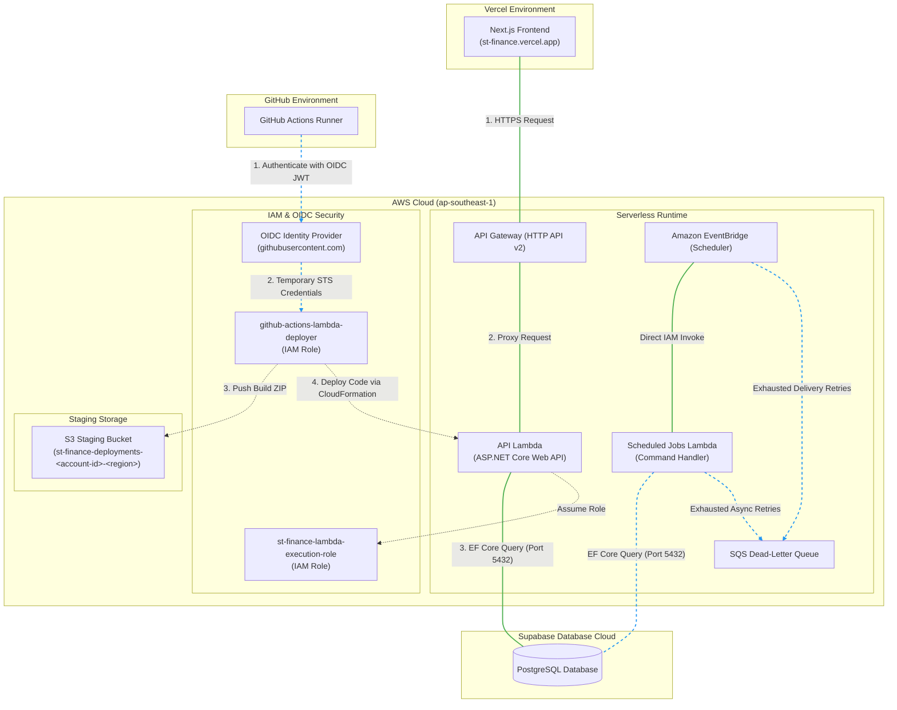

# Financial Manager & Budget Tracker

A tailored, premium financial management, data visualizer, and budget tracker application designed specifically for students. This application features a **Dynamic Safe-to-Spend Quota** and a **Canteen Meal Index** (converting budgets to ~50 Baht canteen meal units) to help students manage their allowance.

---

## 🌐 1. Cloud Architecture & Hosting

This application is built on a modern, cost-efficient, and auto-scaling serverless cloud stack:



### 💻 Frontend (Vercel)
* **Hosting**: Hosted on **Vercel** ([https://st-finance.vercel.app/](https://st-finance.vercel.app/)).
* **Configuration**: Set the following environment variable in the Vercel Settings to connect to the backend:
  * `NEXT_PUBLIC_API_URL`: The HTTPS Invoke URL from API Gateway.

### ⚡ Backend API (AWS Lambda)
* **Hosting**: Deployed as an ASP.NET Core 10 serverless function on **AWS Lambda** behind API Gateway.
* **Configuration**: GitHub Actions reads environment-specific `SecureString` values from SSM Parameter Store, masks them, and passes them as `NoEcho` CloudFormation parameters. CloudFormation injects:
  * `ASPNETCORE_ENVIRONMENT`: `Staging` or `Production`.
  * `ConnectionStrings__DbConnection`: the environment's Supabase connection string.
  * `JwtSettings__SecretKey`: the environment's 32+ character JWT signing key.
  * `Gmail__Username` / `Gmail__Password` / `Gmail__FromEmail`: SMTP credentials for OTP emails.

### ⏰ Cron & Recurring Job Scheduling (EventBridge)
Because Lambda is stateless, the application does not run Hangfire. In production only, **EventBridge Scheduler** assumes a restricted IAM role and directly invokes a dedicated jobs Lambda with a command payload:
1. **Process Recurring (hourly)**: `{ "job": "ProcessRecurringSchedules" }`.
2. **Log Daily Quotas (00:00 Asia/Bangkok)**: `{ "job": "LogDailyQuotas" }`.
* **Security**: no public job endpoint or shared API key exists; IAM authorizes invocation.
* **Reliability**: Scheduler delivery retries and Lambda async retries feed one encrypted SQS DLQ monitored by a CloudWatch alarm.
* **Idempotency**: recurring occurrences have a database uniqueness key, and daily quota rows retain their unique `(UserId, Date)` constraint.

### 🚀 CI/CD Pipeline (GitHub Actions)
Pushes to `staging` and `main` trigger `.github/workflows/deploy-staging.yml` and `.github/workflows/deploy-prod.yml`:
* **Security**: Authenticates with AWS via secure **OpenID Connect (OIDC)** (no permanent credentials stored).
* **Required GitHub Environment variables**:
  * `AWS_ROLE_TO_ASSUME`: Role ARN of your deployer IAM role.
  * `AWS_CLOUDFORMATION_ROLE_ARN`: environment-specific CloudFormation service role.
  * `AWS_LAMBDA_EXECUTION_ROLE_ARN`: environment-specific Lambda runtime role.
  * `AWS_DEPLOYMENT_S3_BUCKET`: environment-specific private deployment bucket.

---

## 💻 2. Quick Local Development

For local testing, the project runs on Kestrel and local PostgreSQL.

### Prerequisites
* [.NET 8.0 SDK](https://dotnet.microsoft.com/download/dotnet/8.0)
* [Node.js (v18+) & npm](https://nodejs.org/)

### 🚀 Commands to Run

```bash
# 1. Start the local database (mounts init.sql automatically)
docker compose up -d db

# 2. Run the Backend API (runs auto-migrations and seeds demo data on empty start)
dotnet run --project ST_finance.Api/ST_finance.Api.csproj

# 3. Start the Frontend UI
cd ST_finance.Frontend
npm install
npm run dev
```
* Local API Docs: `http://localhost:5213/swagger` (Scalar: `/scalar/v1`)
* Local Frontend: `http://localhost:3000`

---

## 📂 3. Project Structure

```text
FinancialManagement/
├── README.md               # Main project introduction & cloud manual
├── docs/                   # Obsidian vault documentation MOC
│   ├── 00-Index.md
│   ├── Goals-and-Scope.md
│   ├── Architecture-Design.md
│   ├── Database-Schema.md
│   ├── Use-Cases.md
│   ├── Environments.md
│   └── AWS-Lambda-Deployment-Guide.md
├── ST_finance.slnx         # Solution file
├── ST_finance.Database/    # EF Core db context and schema configurations
├── ST_finance.Domain/      # Business logic, scheduled job services, and command dispatcher
├── ST_finance.Api/         # Main bootstrapping host and AWS Serverless templates
└── ST_finance.Frontend/    # Next.js client-side application
```

*For deeper engineering guides, see the notes inside the `docs/` folder (fully compatible with Obsidian).*
