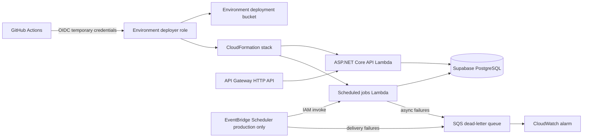

# AWS Lambda Deployment and Operations Guide

This repository deploys the FinancialManagement backend into one AWS account (`079379901631`) in `ap-southeast-1`, with separate staging and production resources.

## Architecture



S3 stores deployment artifacts; it does not serve runtime requests. API Gateway invokes the API Lambda. EventBridge Scheduler directly invokes the jobs Lambda and never calls a public controller.

## Responsibility Boundaries

- **GitHub OIDC deployer role**: reads only its environment's SSM configuration, uploads artifacts to its bucket, and requests updates to its stack.
- **CloudFormation service role**: creates and updates resources for its environment. Production additionally manages Scheduler, SQS, the Scheduler execution role, and the DLQ alarm.
- **Lambda execution role**: writes CloudWatch logs. The production role can also send exhausted asynchronous job invocations to the production DLQ.
- **Scheduler execution role**: exists only in production and can invoke only the production jobs Lambda and send delivery failures to its DLQ.

This separation is least privilege: deployment, infrastructure management, runtime code, and scheduling do not share one all-powerful identity.

## Environment Resources

| Purpose | Staging | Production |
| --- | --- | --- |
| Stack | `st-finance-staging-stack` | `st-finance-prod-stack` |
| Artifact bucket | `st-finance-staging-deployments-079379901631-ap-southeast-1` | `st-finance-production-deployments-079379901631-ap-southeast-1` |
| Database parameter | `/st-finance/staging/db-connection` | `/st-finance/production/db-connection` |
| JWT parameter | `/st-finance/staging/jwt-secret` | `/st-finance/production/jwt-secret` |
| Automatic schedules | None | Hourly recurring processing and daily quota logging |

The jobs Lambda is deployed to both environments so staging can be invoked manually, but Scheduler resources are guarded by the CloudFormation `IsProduction` condition.

## Secure Configuration Flow

The workflows retrieve SSM `SecureString` values after assuming the environment's OIDC role:

```text
SSM SecureString
  -> GitHub runner retrieves and masks value
  -> EF Core uses database value for migrations
  -> value is passed as a NoEcho CloudFormation parameter
  -> CloudFormation injects a Lambda environment variable
```

The repository and GitHub settings never contain database passwords or JWT signing keys. A PostgreSQL URI is accepted; `PostgresConnectionString.Normalize` converts it to Npgsql's key/value format.

Verify parameter metadata without decrypting values:

```bash
AWS_PROFILE=ryan-admin AWS_REGION=ap-southeast-1 \
aws ssm describe-parameters \
  --parameter-filters 'Key=Name,Option=BeginsWith,Values=/st-finance/' \
  --query 'Parameters[].{Name:Name,Type:Type,Version:Version}' \
  --output table
```

Update a database parameter without placing the connection string in shell history:

```bash
export AWS_PROFILE=ryan-admin
export AWS_REGION=ap-southeast-1
read -rsp 'Paste the complete PostgreSQL connection string: ' DB_CONNECTION
echo
aws ssm put-parameter \
  --name /st-finance/staging/db-connection \
  --type SecureString \
  --value "$DB_CONNECTION" \
  --overwrite \
  --no-cli-pager
unset DB_CONNECTION
```

Replace `staging` with `production` for the production parameter. Do not paste either value into chat, source files, or GitHub settings.

## Scheduled Job Contract

The production schedules send one of these events to `ScheduledJobsFunction`:

```json
{ "job": "ProcessRecurringSchedules" }
```

```json
{ "job": "LogDailyQuotas" }
```

`ScheduledJobDispatcher` selects the domain service. Unknown commands throw so failures remain visible to Lambda retry and DLQ handling.

### Delivery and Idempotency

Scheduled and asynchronous delivery is at least once, so the database is the final duplicate-prevention boundary:

- Recurring transactions store `recurring_schedule_id` plus `recurring_occurrence_date` under a unique partial index.
- A retry returns the transaction already created for that occurrence instead of adjusting balances again.
- Daily quota logs retain the unique `(UserId, Date)` index and check for an existing row before insertion.
- The jobs Lambda reserves concurrency at one; database constraints still protect against retries and manual overlapping invocations.

Production uses both Scheduler delivery retries and Lambda asynchronous retries. Exhausted events go to `st-finance-production-scheduled-jobs-dlq`, which has a 14-day retention period and a CloudWatch alarm when visible messages exceed zero.

## CI/CD Sequence

The staging and production workflows perform the same controlled sequence:

1. Check out code and install .NET 10.
2. Restore and run tests.
3. Assume the environment's AWS role through GitHub OIDC.
4. Read and mask the database and JWT SSM parameters.
5. Apply EF Core migrations before new code is deployed.
6. Package the API artifact and upload it to the environment bucket.
7. Ask CloudFormation to create or update the stack with its service role.
8. Read the `ApiURL` stack output and call `/health` to verify Lambda-to-Supabase connectivity.

Staging runs from the `staging` branch. Production runs from `main` and should retain GitHub Environment approval protection.

## Manual Validation Commands

```bash
dotnet restore ST_finance.slnx
dotnet build ST_finance.slnx --no-restore
dotnet test ST_finance.UnitTests/ST_finance.UnitTests.csproj --no-restore

aws cloudformation validate-template \
  --profile ryan-admin \
  --region ap-southeast-1 \
  --template-body file://ST_finance.Api/serverless.template
```

After a successful deployment, obtain the API URLs:

```bash
aws cloudformation describe-stacks \
  --profile ryan-admin \
  --region ap-southeast-1 \
  --stack-name st-finance-staging-stack \
  --query 'Stacks[0].Outputs[?OutputKey==`ApiURL`].OutputValue | [0]' \
  --output text

aws cloudformation describe-stacks \
  --profile ryan-admin \
  --region ap-southeast-1 \
  --stack-name st-finance-prod-stack \
  --query 'Stacks[0].Outputs[?OutputKey==`ApiURL`].OutputValue | [0]' \
  --output text
```

Set each returned URL as the appropriate Vercel `NEXT_PUBLIC_API_URL` value.

## Operations

Manually test a staging worker command after deployment:

```bash
FUNCTION_NAME=$(aws cloudformation describe-stack-resource \
  --profile ryan-admin \
  --region ap-southeast-1 \
  --stack-name st-finance-staging-stack \
  --logical-resource-id ScheduledJobsFunction \
  --query 'StackResourceDetail.PhysicalResourceId' \
  --output text)

aws lambda invoke \
  --profile ryan-admin \
  --region ap-southeast-1 \
  --function-name "$FUNCTION_NAME" \
  --cli-binary-format raw-in-base64-out \
  --payload '{"job":"LogDailyQuotas"}' \
  /tmp/st-finance-job-response.json
```

Inspect production schedule state:

```bash
aws scheduler get-schedule \
  --profile ryan-admin \
  --region ap-southeast-1 \
  --name st-finance-production-process-recurring-schedules

aws scheduler get-schedule \
  --profile ryan-admin \
  --region ap-southeast-1 \
  --name st-finance-production-log-daily-quotas
```

If the DLQ alarm enters `ALARM`, inspect the message before redriving or deleting it. A DLQ entry means all configured delivery or function retries were exhausted.
